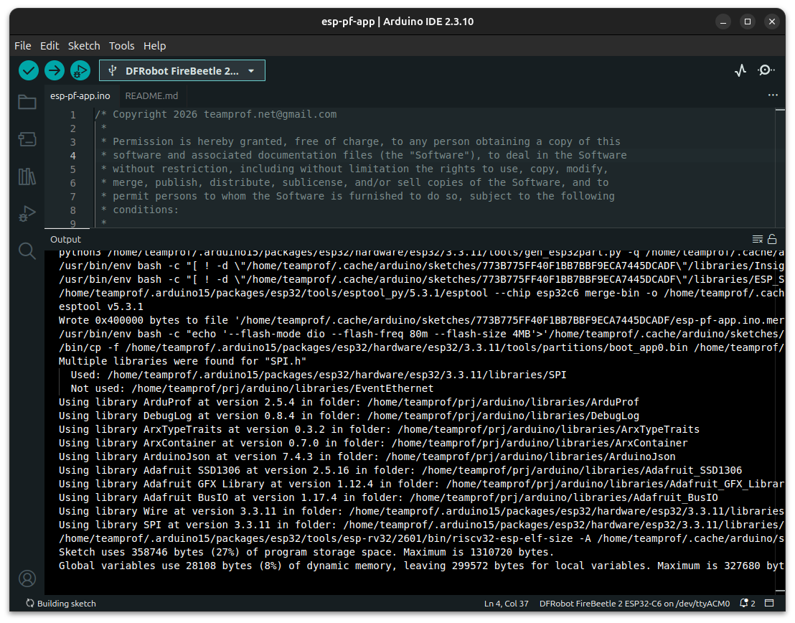
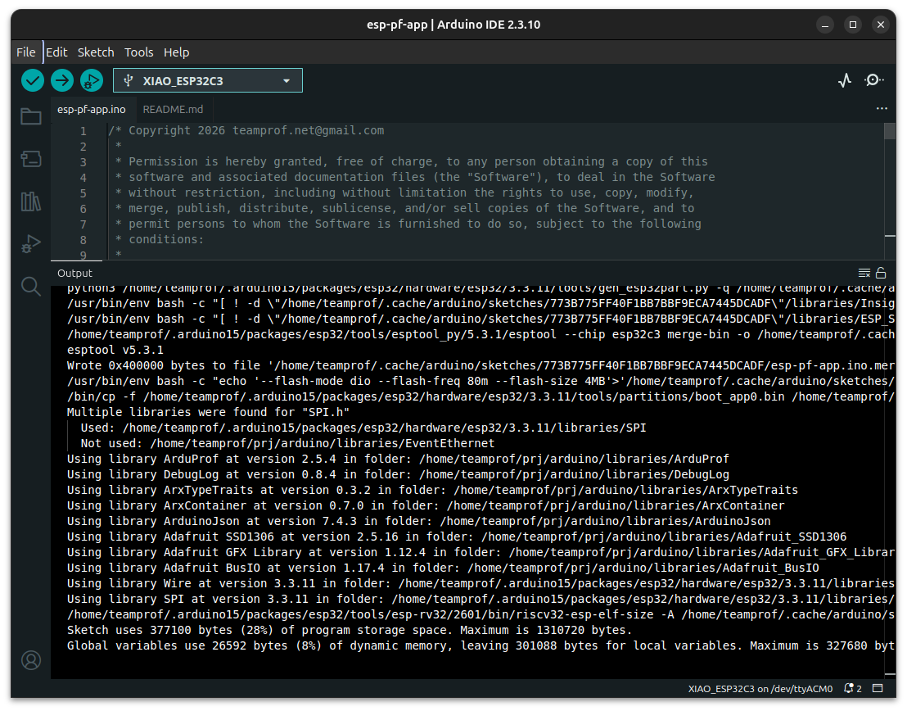
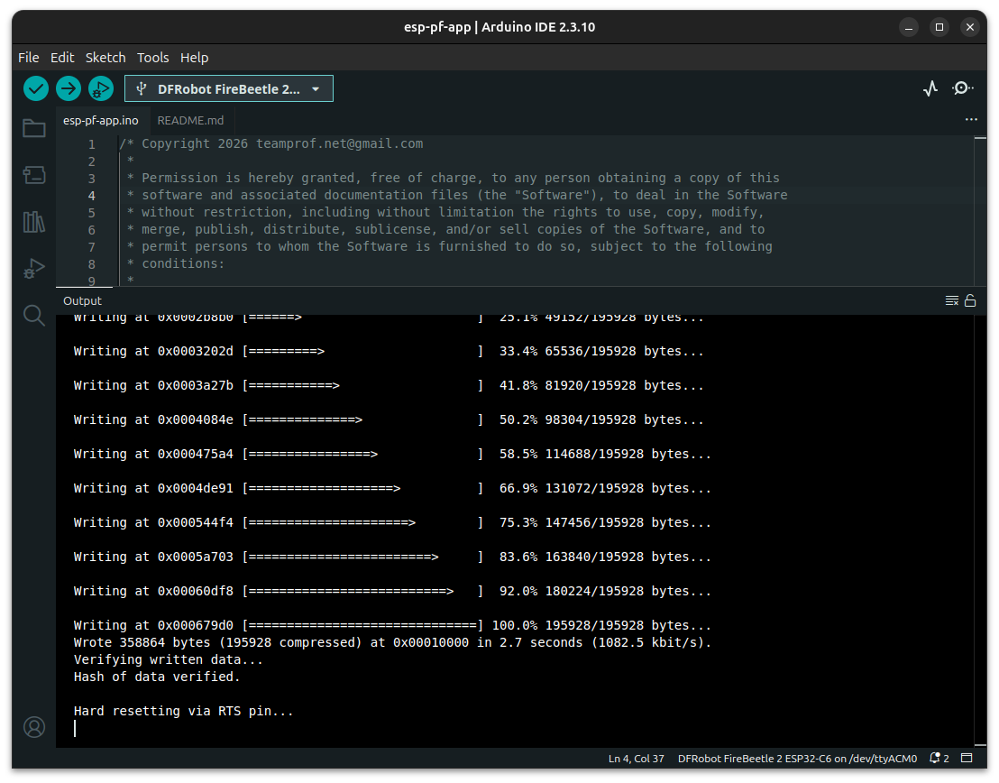
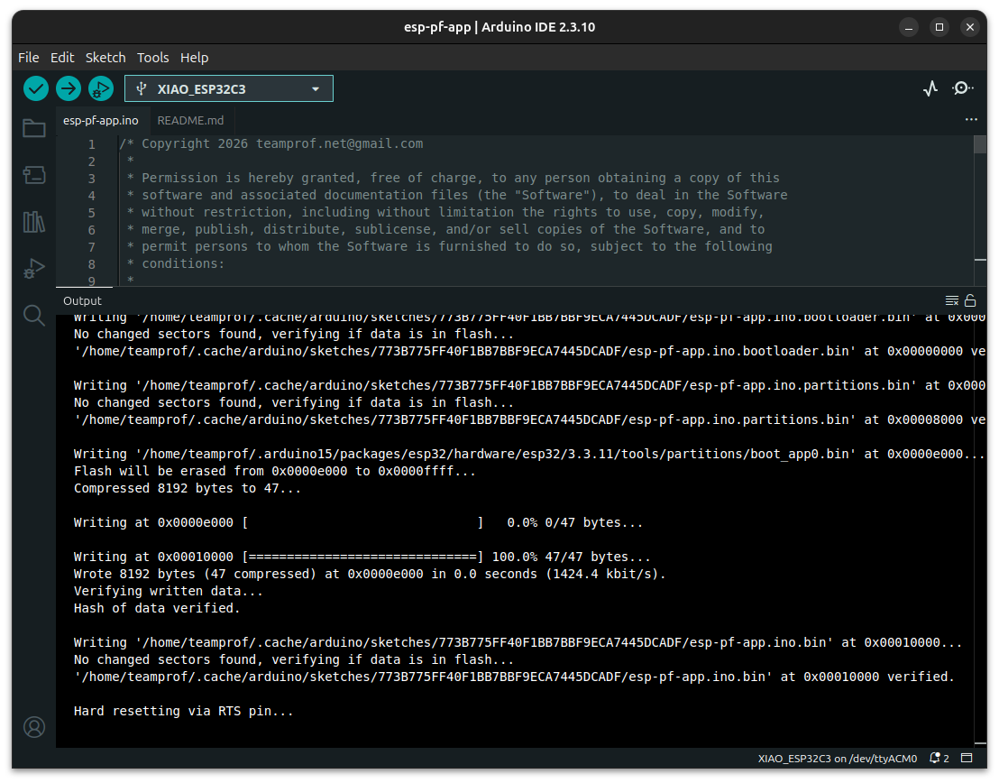
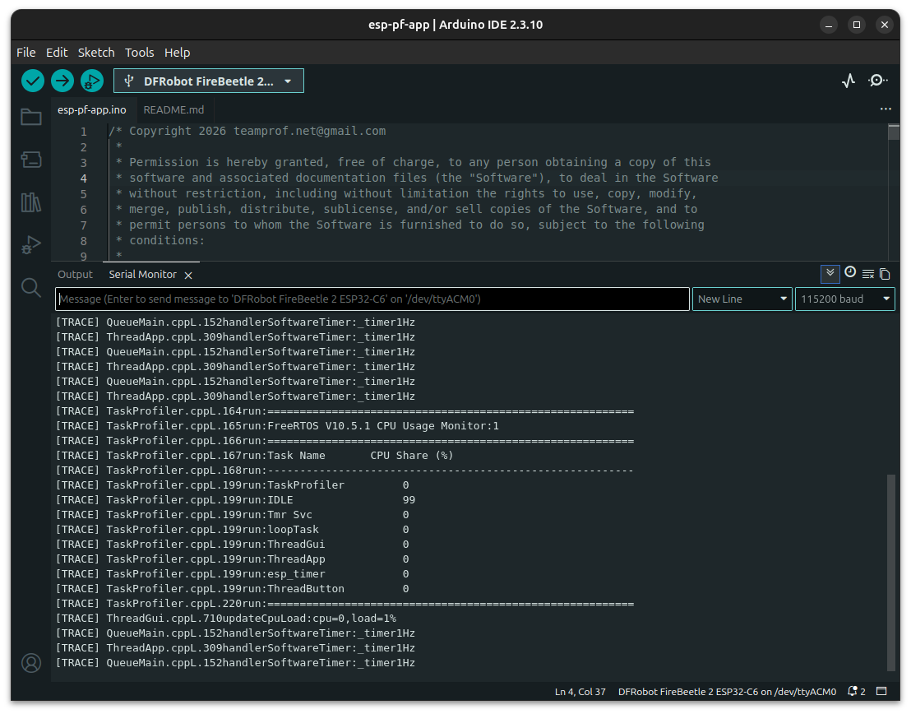
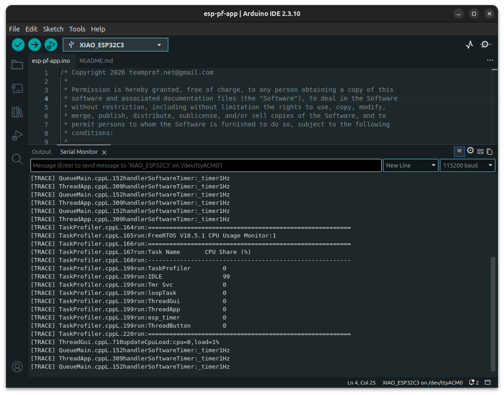
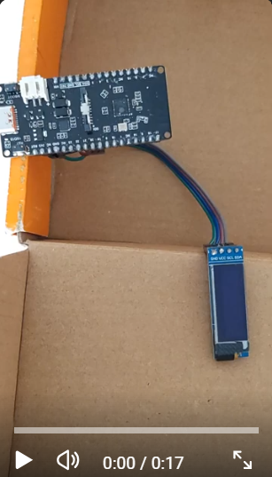
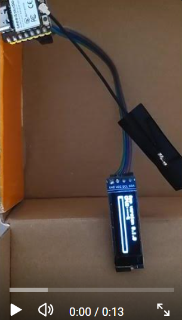

## ESP profiler app running on Arduino

During ESP-series SoC development, running your application alongside a profiler offers invaluable insights into code efficiency and execution bottlenecks on physical hardware. By pinpointing resource-heavy tasks and excessive processing loops early, you can optimize your code to eliminate CPU overloading and maintain smooth system performance.

To monitor these metrics in real time without relying on a serial console, you can pair your setup with an I2C SSD1306 OLED display. Rendering live CPU load percentages on the screen provides immediate visual feedback during hardware testing, making it easy to spot sudden processing spikes as you interact with the device.


[](https://github.com/teamprof/ArduProf/blob/main/LICENSE)

<a href="https://www.buymeacoffee.com/teamprof" target="_blank"></a>


---
## supported Hardware (ESP32-S3, ESP32C3, ESP32C6)
The following boards are supported by this project:
- [FireBeetle 2 ESP32-C6 IoT Development Board](https://bit.ly/452Ueoq)
- [Seeed Studio XIAO ESP32C3](https://bit.ly/4zhsuZD)
- [Seeed Studio XIAO ESP32S3](https://bit.ly/3WPKmNO)
- [Seeed Studio XIAO ESP32C5](https://bit.ly/4iKNAe9)
- [Seeed Studio XIAO ESP32C6](https://bit.ly/4kkGe23)


## Pin assignment

| FireBeetle 2 ESP32-C6 pin | 0.91" OLED 128x32 | remarks     |
| ------------ | ---------- | ----------- |
| GND          | GND        |             |
| 3V3          | VCC        | 3.3V        |
| GPIO20       | SCL        | I2C SCL     |
| GPIO19       | SDA        | I2C SDA     |

| Seeed Studio Xiao ESP32C6 pin | 0.91" OLED | remarks     |
| ---------------- | ---------- | ----------- |
| GND              | GND        |             |
| 3V3              | VCC        | 3.3V        |
| GPIO23           | SCL        | I2C SCL     |
| GPIO22           | SDA        | I2C SDA     |

| Seeed Studio Xiao ESP32C5 pin | 0.91" OLED | remarks     |
| ---------------- | ---------- | ----------- |
| GND              | GND        |             |
| 3V3              | VCC        | 3.3V        |
| GPIO24           | SCL        | I2C SCL     |
| GPIO23           | SDA        | I2C SDA     |

| Seeed Studio Xiao ESP32C3 pin | 0.91" OLED | remarks     |
| ---------------- | ---------- | ----------- |
| GND              | GND        |             |
| 3V3              | VCC        | 3.3V        |
| GPIO7            | SCL        | I2C SCL     |
| GPIO6            | SDA        | I2C SDA     |

| Seeed Studio Xiao ESP32S3 pin | 0.91" OLED | remarks     |
| ---------------- | ---------- | ----------- |
| GND              | GND        |             |
| 3V3              | VCC        | 3.3V        |
| GPIO6            | SCL        | I2C SCL     |
| GPIO5            | SDA        | I2C SDA     |


---
## Software setup for ESP32S3, ESP32C3, ESP32C5, ESP32C6
- Install [Arduino IDE 2.3.7+ for Arduino](https://www.arduino.cc/en/Main/Software)
- Install [Arduino-ESP32](https://docs.espressif.com/projects/arduino-esp32/en/latest/installing.html)
- Install [Adafruit_SSD1306](https://github.com/adafruit/Adafruit_SSD1306)
- Install [Arduino DebugLog](https://www.arduino.cc/reference/en/libraries/debuglog/)
- Install [ArduinoJson v7+](https://github.com/bblanchon/ArduinoJson)
- Install [ArduProf v2.3.1+](https://www.arduino.cc/reference/en/libraries/arduprof/)

---
## ESP32S3/ESP32C3/ESP32C5/ESP32C6 (FreeRTOS)
- Open "arduino-app.ino" under "arduino-app" folder under Arduino IDE
- On Arduino IDE, click menu "Tools" -> "Board: " -> "Board Manager..." ->  
    "DFRobot FireBeetle 2 ESP32-C6" or
    "XIAO_ESP32C3" or
    "XIAO_ESP32S3" or
    "XIAO_ESP32C5" or
    "XIAO_ESP32C6"
- On Arduino IDE, click menu "Tools" -> "USB CDC On Boot:" -> "Enable"
- Build the code by clicking Menu -> “Sketch” -> “Compile/Verify”   
If everything goes smoothly, you should see the following screen.  
#### DFRobot FireBettle 2 ESP32C6 (FreeRTOS)
[](https://github.com/teamprof/arduprof-template/blob/main/assets/build-dfrobot-esp32c6.png)

#### Xiao ESP32C3 (FreeRTOS)
[](https://github.com/teamprof/arduprof-template/blob/main/assets/build-xiao-esp32c3.png)

### Upload firmware
- On Arduino IDE, click Menu -> “Sketch” -> “Upload”  
If everything goes smoothly, you should see the following screen.  

#### DFRobot FireBettle 2 ESP32C6 (FreeRTOS)
[](https://github.com/teamprof/arduprof-template/blob/main/assets/upload-dfrobot-esp32c6.png)

#### Xiao ESP32C3 (FreeRTOS)
[](https://github.com/teamprof/arduprof-template/blob/main/assets/upload-xiao-esp32c3.png)


### Run firmware
- On Arduino IDE, open Serial monitor and then reset the board  
If everything goes smoothly, you should see the following screen.  

#### DFRobot FireBettle 2 ESP32C6 (FreeRTOS)
[](https://github.com/teamprof/arduprof-template/blob/main/assets/run-dfrobot-esp32c6.png)

#### Xiao ESP32C3 (FreeRTOS)
[](https://github.com/teamprof/arduprof-template/blob/main/assets/run-xiao-esp32c3.png)


---
## Video demo
[](https://youtube.com/shorts/ogJey_6108A)  
DFRobot ESP32C6 video demo is available on [video](https://youtube.com/shorts/ogJey_6108A)  

[](https://youtube.com/shorts/nvneYgeBysY)  
Xiao ESP32C3 video demo is available on [video](https://youtube.com/shorts/nvneYgeBysY)  


---
## Arduino code explanation
In a typical Arduino setup(), both QueueMain and ThreadApp are initialized. QueueMain runs within the Arduino loop(), while ThreadApp executes in parallel. The purpose of QueueMain is to establish a communication channel between the Arduino loop() and other threads.
```
static void startTasks(void)
{
    auto ctx = getAppContext();
    if (ctx->queueMain)
    {
        static_cast<QueueMain *>(ctx->queueMain)->start(ctx);
    }
    if (ctx->threadApp)
    {
        ctx->threadApp->start(ctx);
    }
}

void loop()
{
    auto& ctx = getAppContext();
    auto qMain = static_cast<QueueMain *>(ctx.queueMain);
    assert(qMain);
    qMain->messageLoop(0); // non-blocking
    // qMain->messageLoop();  // blocking until event received and proceed
    // qMain->messageLoopForever(); // never return
    delay(100); // delay 0.1s
}
```

## Add new thread(s)
- Copy the files "ThreadApp.cpp" and "ThreadApp.h" and rename them, for example "ThreadGui"
- Edit "ThreadGui.h", modify the CLASSNAME macro as below: 
``` 
#define CLASSNAME ThreadGui
```
- Edit "AppContext.h", modify the AppContext struct as below: 
```
    typedef struct _AppContext
    {
        ardufreertos::MessageQueue *queueMain;
        ardufreertos::ThreadBase *threadApp;
        ardufreertos::ThreadBase *threadGui;
    } AppContext;

    typedef struct _AppContext
    {
        ardumbedos::MessageQueue *queueMain;
        ardumbedos::ThreadBase *threadApp;
        ardumbedos::ThreadBase *threadGui;  // <= add code here
    } AppContext;
```
- Edit "AppContext.cpp", modify the AppContext code as below: 
```
    static AppContext appContext = {
        .queueMain = &queueMain,
        .threadApp = ThreadApp::getInstance(),
        .threadGui = ThreadGui::getInstance(),  // <= add code here
    };
```
- Edit "arduino-app.ino", modify the startTasks code as below: 
```
static void startTasks(void)
{
    auto ctx = getAppContext();
    if (ctx->queueMain)
    {
        static_cast<QueueMain *>(ctx->queueMain)->start(ctx);
    }
    if (ctx->threadApp)
    {
        ctx->threadApp->start(ctx);
    }

    //////////////////////////////////////////////////////
    // add code here
    //////////////////////////////////////////////////////
    if (ctx->threadGui)
    {
        ctx->threadGui->start(ctx);
    }
}
```
- The new ThreadGui is added. Build the updated code, upload the new firmware, the new thread should run in parellel with ThreadApp and QueueMain.
- Please refer to [ArduProf](https://github.com/teamprof/arduprof) about sending and handling messages between threads

---
### License
- The project is licensed under GNU GENERAL PUBLIC LICENSE Version 3
---

### Copyright
- Copyright 2026 teamprof.net@gmail.com. All rights reserved.
---


